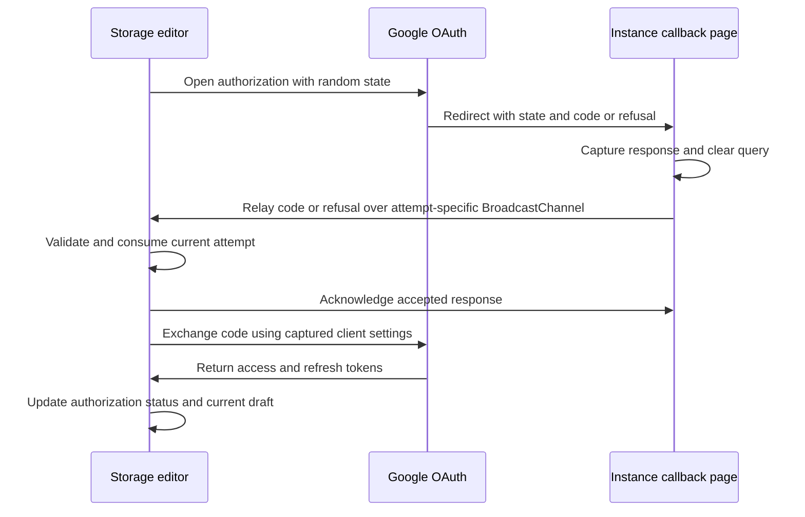

# Google Drive storage authorization

The initiating storage editor keeps the draft, entered client secret and Google tokens in memory. It opens Google with the configured client ID, the instance’s `/storages/google-oauth` redirect URI and a random state. The state contains no credentials or serialized draft.

The callback sends no credentials and requires no opener relationship. It stops waiting after five seconds if the initiating editor is unavailable. The editor rejects responses for canceled, replaced, expired or consumed attempts and ignores obsolete exchange completions. [The frontend architecture](architecture.md#frontend) describes ownership and lifetime rules.

Authorization does not save a storage or change the surrounding backup configuration. The user explicitly tests the connection and saves through the existing storage API. Saved credentials remain omitted from API responses; renaming a saved storage needs no secret re-entry, while reconnecting requires the client secret again.

Reloading the original tab loses the attempt and requires a fresh authorization. A callback whose state matches no current attempt is rejected. Browser-held secrets remain accessible to the browser user and code running in the application origin. Direct Google token exchange still depends on the provider’s CORS policy and the user’s client configuration; failures produce local feedback without automatic retries or a backend fallback.
